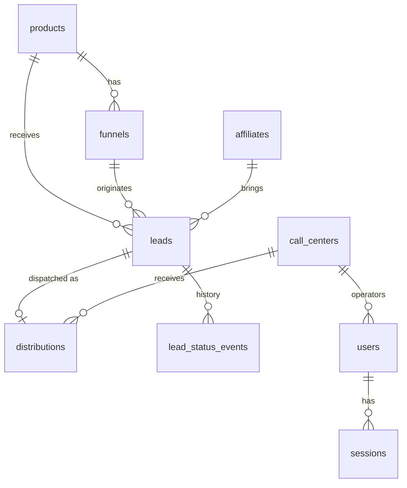

# PLAN.md — Elevate Lead Dispatcher

> Plano técnico do teste (Full Stack Sênior · Grupo Elevate). Fonte de verdade de escopo, arquitetura e decisões.
> Repositório: https://github.com/vLecaBR/Elevate-Lead-Dispatcher · Pasta local: `C:\Code\Elevate-Lead-Dispatcher` (Windows). Detalhes na §0.1.
> Idioma: documentação em português; código, identificadores, mensagens de commit e nomes de tabela em inglês.
> Itens marcados com **[MEDIR]** devem ser medidos na sua máquina e o número real vai para o README (não copie estimativas daqui).

---

## 0. Resumo executivo

| Tema | Decisão |
|---|---|
| Stack | TypeScript · Node.js · Fastify · Drizzle ORM · PostgreSQL 17 · Next.js (App Router) · Docker Compose |
| Alinhamento com a vaga | Stack principal da vaga: TS, Node, React/Next, PostgreSQL, Docker, Git/GitHub, REST, Webhooks, CI/CD |
| Repositório | GitHub `vLecaBR/Elevate-Lead-Dispatcher`, clone local já criado e vazio, branch `main`, histórico linear (§0.1) |
| Componentes extras | **Nenhum** (sem Redis, sem fila, sem worker). Tudo em PostgreSQL. Justificativa na §3.4 |
| Recebimento de leads | `POST /api/leads`, validação com Zod, normalização (e-mail, telefone E.164), idempotência por `dedupe_key` com `UNIQUE` |
| Dispatcher | Smooth Weighted Round Robin com estado persistido, executado na **mesma transação** do insert do lead, serializado por `SELECT ... FOR UPDATE` nas linhas de `call_centers` |
| Webhook | HMAC-SHA256 por call center + janela de timestamp; dedupe por `event_key`; **log de eventos append-only + reducer determinístico** para lidar com eventos fora de ordem |
| Auth | Sessão server-side (cookie httpOnly + SameSite=Strict), Argon2id, RBAC com *default-deny* e escopo de call center no repositório |
| Paginação | Keyset (cursor) em `(created_at, id)`; sem `COUNT(*)` na listagem |
| Testes | Vitest com PostgreSQL real (concorrência exige locks reais) |

### 0.1 Repositório e ambiente local

| Item | Valor |
|---|---|
| Remoto | `https://github.com/vLecaBR/Elevate-Lead-Dispatcher` (`origin` já configurado) |
| Pasta local | `C:\Code\Elevate-Lead-Dispatcher` (clone, branch `main`) |
| Estado inicial | Só a pasta `.git`, nenhum commit ainda. **Não rodar `git init`** |
| Sistema | Windows (PowerShell, cmd ou Git Bash) com Docker Desktop (WSL2) |
| Fluxo de branch | Direto em `main`, histórico linear. Sem `rebase`, `amend` após push, `reset --hard` ou `push --force` |
| Push | Ao fim de cada fase, depois que o autor revisou o diff |
| Entrega | Link do repositório. Na entrega, garantir que o avaliador consegue acessar (repositório público ou convite) |

Cuidados específicos de Windows (valem para todas as fases):
- **Finais de linha LF.** O `.gitattributes` (`* text=auto eol=lf`) vai no primeiro commit. Sem ele, `.sh`, Dockerfiles e migrations podem ir com CRLF e quebrar dentro do container Linux.
- **Scripts portáteis.** `package.json` e scripts não podem depender de bash (`export`, `rm -rf`, `cp`). Usar scripts Node (`node scripts/x.mjs`) e `node --env-file=.env`. Dependência extra para isso (ex.: `cross-env`) só com aprovação.
- **Caminhos.** `path.join`/`path.resolve` no código; `/` em compose, tsconfig e Dockerfile.
- **Docker.** `docker compose` v2. Sem bind mount de `node_modules`; as imagens fazem `npm ci` no build.
- **Porta do Postgres.** O compose mapeia `${DB_PORT:-5432}:5432`. Se já houver Postgres local na 5432, mudar `DB_PORT` no `.env` e a porta em `DATABASE_URL`/`TEST_DATABASE_URL`.
- **README.** Mostrar o comando de cópia do `.env` nas duas formas (`cp .env.example .env` e `Copy-Item .env.example .env`).

---

## 1. Escopo e priorização

O enunciado (§27) diz que o núcleo é: **recebimento de leads, banco de dados, dispatcher com concorrência e webhook**. Isso deve estar excelente. O resto pode ser menor, desde que funcional e documentado.

### Núcleo (não negociável)
- Schema + migrations + seed
- `POST /api/leads` com validação e idempotência
- Dispatcher 50/30/20 sem race condition + teste de concorrência
- `POST /api/webhooks/callcenter` com HMAC, dedupe e eventos fora de ordem
- Testes unitários, de integração e de concorrência dessas partes
- `docker compose up` funcionando
- README completo e histórico de commits incremental

### Importante (fazer em versão enxuta)
- Auth com ADMIN e OPERATOR, autorização no backend, escopo por call center
- Listagem com filtros e paginação, métricas do dashboard
- Frontend funcional (login, dashboard, tabela, detalhe com troca de status)

### Cortável (nesta ordem, se o tempo apertar)
1. Testes de frontend
2. OpenAPI/Swagger em `/docs`
3. GitHub Actions
4. Tela de edição de pesos do dispatcher (manter só o endpoint e documentar)
5. Lockout de conta (manter só rate limit no login)

> Regra: se for escolher entre mais features e algo sólido e documentado, escolha o sólido (§32 do enunciado).

---

## 2. Stack e justificativa

| Camada | Escolha | Por quê (para o README) |
|---|---|---|
| Runtime | Node.js LTS + TypeScript `strict` | Stack principal da vaga |
| HTTP | **Fastify** | Leve, rápido, schema-first, `inject()` facilita testes de integração/concorrência, ótimo suporte a `rawBody` para HMAC. NestJS adicionaria cerimônia sem ganho para este escopo |
| Validação | **Zod** | Mesma lib para env, payloads e query strings; tipos inferidos |
| Acesso a dados | **Drizzle ORM** + drizzle-kit | SQL próximo do metal: suporta `FOR UPDATE`, `ON CONFLICT`, índices parciais e `DESC`; migrations em SQL versionado. Prisma não tem lock de linha nativo (exigiria raw SQL no ponto mais crítico) |
| Banco | **PostgreSQL 17** | Exigido pela vaga; locks de linha, `ON CONFLICT`, jsonb, índices parciais, particionamento |
| IDs | UUIDv7 gerado na aplicação | Ordenável por tempo: melhor localidade de índice que UUIDv4 e mantém o formato `lead_id` do enunciado |
| Telefone | `libphonenumber-js` | Validação real e normalização E.164 |
| Senhas | Argon2id (`@node-rs/argon2`, binários prebuilt, evita compilar no Alpine) | OWASP recomenda |
| Frontend | **Next.js** (App Router) + Tailwind + TanStack Query | Stack da vaga; proxy `/api/*` → backend elimina CORS e simplifica cookies |
| Testes | **Vitest** | Rápido, TS nativo, serve para API e web |
| Infra | Docker Compose; GitHub Actions (se sobrar tempo) | Vaga pede Docker e CI/CD |

Versões: use as atuais estáveis e fixe no lockfile. Não escreva versões no código sem checar.

---

## 3. Arquitetura

### 3.1 Visão geral

```
                      ┌────────────────────────────┐
 Landing pages ─────► │  POST /api/leads (público)  │
                      │                            │
 Call centers ──────► │  POST /api/webhooks/       │        ┌──────────────┐
  (HMAC)              │       callcenter           │ ─────► │ PostgreSQL   │
                      │         Fastify API        │        │ (única fonte │
 Browser (cookie) ──► │  /api/auth /leads /admin   │ ◄───── │  de estado)  │
   ▲                  └────────────────────────────┘        └──────────────┘
   │ rewrite /api/*
 Next.js (web)
```

### 3.2 Fluxo de um lead (vai para o README)

1. Landing page envia `POST /api/leads`.
2. API valida (Zod), normaliza e resolve `product`, `funnel` (deve pertencer ao produto) e `affiliate` (find-or-create).
3. **Transação única:**
   1. `INSERT lead ... ON CONFLICT (dedupe_key) DO NOTHING RETURNING id`. Se não retornou: duplicata → devolve o lead existente (200) e encerra.
   2. Registra evento inicial `new` em `lead_status_events`.
   3. Dispatcher: `SELECT ... FOR UPDATE` nos call centers ativos (ordenados por id) → escolhe via SWRR → atualiza créditos → `INSERT distribution` → atualiza `leads.call_center_id`.
   4. `COMMIT`.
4. Resposta `201 {success, lead_id, duplicate:false}`. Se não há call center ativo, o lead fica **pendente** (`call_center_id IS NULL`) e a resposta continua 201.
5. Call center envia webhook assinado. A API verifica HMAC e timestamp, localiza o lead (precisa estar distribuído para aquele call center), grava o evento (dedupe), recalcula o status pelo reducer e atualiza a projeção `leads.status`.
6. ADMIN/OPERATOR acompanham no frontend; OPERATOR também pode atualizar status manualmente (gera evento `source=operator`).

### 3.3 Estrutura de pastas

```
.
├── CLAUDE.md
├── PLAN.md
├── README.md
├── .gitignore · .gitattributes         # LF forçado (Windows)
├── docker-compose.yml
├── .env.example
├── .github/workflows/ci.yml            # se sobrar tempo
├── docs/
│   ├── decisions/                      # ADRs curtos (um por decisão relevante)
│   └── ai/AI-LOG.md                    # diário real de uso de IA
├── scripts/
│   ├── load-leads.mjs                  # dispara N leads concorrentes (demo)
│   └── send-webhook.mjs                # assina e envia webhooks (demo)
├── apps/
│   ├── api/
│   │   ├── Dockerfile
│   │   ├── drizzle.config.ts
│   │   ├── src/
│   │   │   ├── server.ts · app.ts      # app = factory testável
│   │   │   ├── config/env.ts           # Zod
│   │   │   ├── db/{client,schema,migrate,seed,seed-bulk}.ts
│   │   │   ├── db/migrations/*.sql
│   │   │   ├── plugins/                # security headers, rate limit, auth, error handler, rawBody
│   │   │   ├── shared/                 # errors, pagination (cursor), crypto helpers, time
│   │   │   └── modules/
│   │   │       ├── leads/              # routes · schema · service · repository · normalize
│   │   │       ├── dispatcher/         # algorithm.ts (PURO) · service · admin routes
│   │   │       ├── status/             # state-machine.ts (PURO) · reducer.ts (PURO) · service
│   │   │       ├── webhooks/           # routes · signature.ts (PURO) · service
│   │   │       ├── auth/               # routes · service · password · session · guards
│   │   │       ├── dashboard/          # metrics queries
│   │   │       └── catalog/            # produtos, funis, call centers (filtros do front)
│   │   └── test/{unit,integration,concurrency}/
│   └── web/
│       ├── Dockerfile
│       └── src/app/{login,dashboard,leads,admin/dispatcher}/...
```

Camadas e regras:
- **Domínio puro** (`algorithm.ts`, `state-machine.ts`, `reducer.ts`, `signature.ts`, normalizadores): sem I/O, testável sem banco.
- **Service**: orquestra transações e regras. **Repository**: único lugar com SQL. **Route**: só HTTP (parse, auth, resposta).
- Nenhum SQL em rota; nenhuma regra de negócio em repository.

### 3.4 Por que não Redis / fila / worker

- O dispatcher precisa de atomicidade com o insert do lead e do registro da distribuição. Fazer tudo na mesma transação PostgreSQL entrega isso sem sistema distribuído.
- Um serviço a menos para operar, testar e explicar.
- O custo é um ponto de serialização no dispatcher (§15 explica como evoluir: contadores atômicos em Redis e/ou fila com consumidor único por partição).
- Rate limit usa store em memória (single instance). Em multi-instância usaria o store Redis do mesmo plugin. Documentar.

---

## 4. Modelo de dados



### Tabelas (colunas principais; tipos exatos ficam no schema Drizzle)

**products**: `id uuid pk`, `slug text unique`, `name`, `is_active bool`, `created_at`.

**funnels**: `id`, `product_id fk`, `slug`, `name`, `is_active`, `created_at`. `UNIQUE (product_id, slug)`.

**affiliates**: `id`, `external_code text unique`, `created_at`. Criado automaticamente na primeira vez que aparece (não perder lead por afiliado desconhecido).

**call_centers**: `id`, `slug unique`, `name`, `weight int CHECK (weight >= 0)`, `is_active`, `dispatch_credit bigint default 0` (estado do SWRR), `webhook_secret text`, `created_at`, `updated_at`. Segredo nunca é retornado por API.

**leads**
- `id uuid pk (v7)`, `name`, `email`, `phone_e164`
- `product_id fk`, `funnel_id fk`, `affiliate_id fk null`
- `source`, `campaign`, `utm_source`, `utm_medium`, `utm_campaign`, `utm_content`, `utm_term` (todos nullable)
- `status lead_status NOT NULL default 'new'` (**projeção** do log de eventos)
- `status_updated_at`
- `call_center_id fk null`, `distributed_at null` (**denormalização consciente**: ver nota)
- `dedupe_key text NOT NULL UNIQUE`, `request_hash text NOT NULL`
- `created_at timestamptz default now()`, `updated_at`

> Nota de denormalização: `distributions` é o registro de auditoria (estratégia, snapshot de pesos/créditos). `leads.call_center_id` espelha a escolha para permitir índice composto no filtro mais quente (operador por call center + status + data) e `IS NULL` = pendente com índice parcial. Os dois são escritos na mesma transação; teste de integração verifica consistência.

**distributions**: `id`, `lead_id fk UNIQUE`, `call_center_id fk`, `strategy text` (`swrr`), `weights_snapshot jsonb`, `external_id text null`, `distributed_at`. `UNIQUE(lead_id)` garante no máximo uma distribuição por lead mesmo que haja bug de aplicação.

**lead_status** (enum PostgreSQL): `new, contacted, no_answer, callback, qualified, sale, refund, invalid`.

**lead_status_events** (append-only, auditoria)
- `id bigint identity pk`, `lead_id fk`
- `status lead_status`, `event_ts timestamptz` (momento do evento segundo a origem)
- `received_at timestamptz default now()`
- `source enum('system','webhook','operator')`
- `call_center_id fk null`, `actor_user_id fk null`, `external_id text null`
- `event_key text NOT NULL`, `payload jsonb null`, `note text null`
- `UNIQUE (lead_id, event_key)` → dedupe de webhook

**users**: `id`, `email unique (lowercase)`, `password_hash`, `role enum('ADMIN','OPERATOR')`, `call_center_id fk null`, `is_active`, `failed_login_count`, `locked_until null`, `created_at`.
`CHECK ((role = 'OPERATOR') = (call_center_id IS NOT NULL))`. Operator sem call center é impossível por constraint.

**sessions**: `token_hash text pk` (sha256 do token), `user_id fk`, `created_at`, `expires_at`.

### Migrations
- drizzle-kit gera SQL; **revise e edite à mão** quando o gerador não expressar algo (checks, índices parciais).
- Migrations são commitadas (com LF), aplicadas por um serviço one-shot no compose (`migrate`) e pelos testes (globalSetup).

---

## 5. Índices

| Índice | Consulta que otimiza |
|---|---|
| `leads` PK `(id)` | Lookup por `lead_id` (webhook, detalhe) |
| `UNIQUE leads(dedupe_key)` | Idempotência (`ON CONFLICT`) |
| `leads(created_at DESC, id DESC)` | Listagem padrão ADMIN, keyset, "leads hoje", filtro por período |
| `leads(call_center_id, created_at DESC, id DESC)` | Lista do OPERATOR e filtro por call center |
| `leads(status, created_at DESC, id DESC)` | Filtro por status; contagem de vendas |
| `leads(product_id, funnel_id, created_at DESC, id DESC)` | Filtros de produto/funil (funil implica produto) |
| `leads(source, created_at DESC, id DESC)` | Filtro por origem |
| `leads(id) WHERE call_center_id IS NULL` (parcial) | Fila de pendentes (índice minúsculo) |
| `lead_status_events(lead_id, event_ts)` + `UNIQUE(lead_id, event_key)` | Reducer e dedupe |
| `distributions(call_center_id, distributed_at DESC)` | Resumo do dispatcher por call center |
| `users(email)` UNIQUE, `sessions(token_hash)` PK | Login e autenticação por request |
| `funnels(product_id, slug)` UNIQUE | Resolução do funil no intake |

Não indexar: `name`, `email`, `phone` (nenhuma tela busca por eles na v1), `affiliate_id` (sem filtro no enunciado). Deixar documentado como índice futuro se surgir busca.

Custo: 6 índices na tabela `leads` amplificam escrita. Aceitável neste volume; revisar com `pg_stat_user_indexes` e remover o que não for usado.

**Evidência para o README:** script `seed-bulk` insere 100k leads com `generate_series`; rode `EXPLAIN (ANALYZE, BUFFERS)` nas 4–5 consultas principais **[MEDIR]** e cole os resultados (com e sem índice, se quiser mostrar o ganho).

---

## 6. API

Formato de erro único:
```json
{ "success": false, "error": { "code": "validation_error", "message": "...", "details": [{ "field": "phone", "issue": "invalid_phone" }] } }
```

| Método e rota | Auth | Descrição |
|---|---|---|
| `POST /api/leads` | pública (rate limit) | Intake |
| `POST /api/webhooks/callcenter` | HMAC | Atualização de status |
| `GET /health` · `GET /ready` | pública | Liveness · readiness (ping no banco) |
| `POST /api/auth/login` · `POST /api/auth/logout` · `GET /api/auth/me` | login público | Sessão |
| `GET /api/leads` | autenticada, **escopada** | Lista com filtros e cursor |
| `GET /api/leads/:id` | autenticada, escopada | Detalhe + distribuição + histórico + `allowed_next` |
| `POST /api/leads/:id/status` | autenticada, escopada | Troca manual de status |
| `GET /api/catalog` | autenticada, escopada | Produtos, funis, call centers, origens (para filtros) |
| `GET /api/dashboard/metrics` | ADMIN | Métricas |
| `GET /api/admin/dispatcher` | ADMIN | Pesos, % alvo vs % real, pendentes |
| `PATCH /api/admin/call-centers/:id` | ADMIN | Peso e ativo/inativo (zera créditos) |
| `POST /api/admin/dispatcher/redispatch-pending` | ADMIN | Distribui pendentes (lotes, `SKIP LOCKED`) |

Status HTTP: `201` criado · `200` duplicata/replay · `400` JSON malformado · `401` não autenticado/assinatura inválida · `403` sem permissão · `404` não encontrado **ou fora do escopo** · `409` transição inválida · `413` corpo grande · `415` content-type · `422` validação · `429` rate limit · `503` lock timeout (com `Retry-After`).

---

## 7. Recebimento de leads

### Validação (Zod)
- `name`: trim, 2–120 chars, obrigatório.
- `email`: formato válido, ≤254, normalizado para minúsculas.
- `phone`: parse com libphonenumber-js (região padrão `DEFAULT_PHONE_REGION=BR` se vier sem `+`), precisa ser válido, armazenado em E.164.
- `product`: slug existente e ativo, senão `422 unknown_product`.
- `funnel`: deve existir **para aquele produto** e estar ativo, senão `422 unknown_funnel`.
- `source`: string 1–64, minúsculas. `campaign`: opcional ≤128. `affiliate_id`: string opcional ≤64 (número JSON é rejeitado: tipo esperado é string).
- `utm`: objeto opcional `.strict()` com `source, medium, campaign, content, term` (strings ≤128). Chave desconhecida → 422.
- Campos desconhecidos no topo são descartados (landing pages evoluem; não perder lead por campo extra). UTM é estrito porque o enunciado pede "estrutura correta".
- Tamanho máximo do corpo: 16 KB.

### Idempotência e duplicidade
Duas camadas, uma única coluna `dedupe_key UNIQUE`:
1. **Header `Idempotency-Key`** (opcional): `dedupe_key = "idem:" + sha256(key)`. Mesma chave com corpo diferente (`request_hash` difere) → `422 idempotency_key_reuse`.
2. **Sem header**: `dedupe_key = "fp:" + sha256(product | funnel | email_normalizado | phone_e164)`. Mesma pessoa no mesmo funil do mesmo produto = mesmo lead.

Inserção: `INSERT ... ON CONFLICT (dedupe_key) DO NOTHING RETURNING id`. Se vazio, busca o existente e responde `200 {success:true, lead_id, duplicate:true}` sem nova distribuição. A constraint única é o árbitro: 100 requisições idênticas simultâneas criam exatamente 1 lead (teste de concorrência).

Trade-off assumido (README): sem janela de tempo, quem se recadastra meses depois no mesmo funil volta como duplicata. Alternativa futura: janela configurável embutida na chave. Em tabela particionada isso exige tabela separada de dedupe (§15).

---

## 8. Dispatcher

### Algoritmo: Smooth Weighted Round Robin (SWRR)
```
pick(centers):                       # só ativos com weight > 0, ordenados por id
  total = Σ weight
  para cada c: c.credit += c.weight
  chosen = c com maior credit (empate → menor id)
  chosen.credit -= total
  return chosen
```
Por que SWRR (para o README):
- **Determinístico e exato**: a cada 10 leads (pesos 50/30/20) a distribuição é exatamente 5/3/2 e os créditos voltam a 0. Random só converge no longo prazo e torna testes flaky.
- **Suave**: intercala em vez de mandar 5 seguidos para o A (é o algoritmo do nginx).
- **Estado mínimo**: um inteiro por call center, persistido no banco.
- **Função pura**: testável sem banco.

Sequência dourada (pesos 50/30/20, desempate pelo menor id), usar como fixture de teste:
`A, B, C, A, A, B, A, C, B, A` e depois repete.

Regras de configuração:
- Pesos são relativos (não precisam somar 100). Peso 0 ou `is_active=false` tira o call center da rotação.
- Qualquer mudança de peso/atividade **zera todos os créditos** na mesma transação (evita rajada de compensação).
- Sem call center elegível → lead fica pendente; `redispatch-pending` distribui depois, em ordem de criação, usando a mesma função.

### Concorrência
Problema: duas requisições leem o mesmo crédito e escolhem o mesmo call center, ou perdem um update.

Solução: dentro da transação do lead,
```sql
SELECT id, weight, dispatch_credit FROM call_centers
WHERE is_active AND weight > 0
ORDER BY id
FOR UPDATE;
```
- Lock de linha serializa os dispatchers: o segundo só lê o estado depois do commit do primeiro (READ COMMITTED reavalia a linha travada).
- `ORDER BY id` fixa a ordem de aquisição de locks → sem deadlock entre dispatchers.
- O lock é adquirido **depois** do insert do lead e fica retido só durante pick + update + insert de distribuição + commit (janela de poucos ms).
- `SET LOCAL lock_timeout = '3s'` e `statement_timeout`: sob saturação responde `503 + Retry-After` em vez de empilhar conexões.
- Isolamento READ COMMITTED com lock explícito (não SERIALIZABLE: evita retries de serialização e é mais simples de explicar).
- `distributions.lead_id UNIQUE` é a segunda barreira.

Ponto de serialização: é um gargalo conhecido e aceito. **[MEDIR]** a vazão com `scripts/load-leads.mjs` e registre o número no README junto com o plano de evolução (§15).

---

## 9. Webhook do call center

### 9.1 Segurança: HMAC por call center
Headers:
- `X-Callcenter-Id: <slug>` (seleciona o segredo)
- `X-Elevate-Timestamp: <unix seconds>`
- `X-Elevate-Signature: sha256=<hex>` onde `hex = HMAC_SHA256(secret, timestamp + "." + rawBody)`

Regras:
- Usar o **corpo cru** (parser que preserva o buffer) e `crypto.timingSafeEqual`.
- Rejeitar se `|now - timestamp| > 300s` (anti-replay). Retry legítimo do provedor reassina com novo timestamp; o dedupe cuida do restante.
- Resposta `401` genérica para call center desconhecido, assinatura inválida ou timestamp fora da janela (não vazar qual dos três).
- **Autorização**: o lead precisa estar distribuído para o call center que assinou; senão `403` (ou `404`). Um call center não atualiza lead de outro.
- Por que HMAC e não API key: a assinatura cobre o corpo (integridade), o segredo não trafega, e o timestamp limita replay. Limitação documentada: rotação de segredo (aceitar `current` e `previous`) fica para v2.

### 9.2 Idempotência de webhook
`event_key = sha256(call_center_id | external_id | status | event_ts normalizado em UTC)`; se o provedor enviar um `event_id`, ele passa a compor a chave (campo opcional aceito). `INSERT ... ON CONFLICT (lead_id, event_key) DO NOTHING`. Se não inseriu → `200 {result:"duplicate"}`. Respondemos 2xx para o provedor parar de reenviar.

Tudo ocorre numa transação que começa com `SELECT ... FROM leads WHERE id = $1 FOR UPDATE`, serializando webhooks concorrentes do mesmo lead.

### 9.3 Eventos fora de ordem: log + reducer

Problema: `contacted` pode chegar depois de `sale`; pior, `refund` pode chegar antes do `sale` atrasado.

Abordagem: **a tabela de eventos é a verdade; `leads.status` é uma projeção recalculada**. A cada evento novo:
1. Insere o evento (dedupe).
2. Carrega todos os eventos do lead (poucos por lead).
3. Ordena por `(event_ts, rank(status), id)`.
4. Aplica a máquina de estados do `new` em diante, **ignorando** transições inválidas.
5. Atualiza `leads.status` e `status_updated_at` se mudou.

Resultado: o status final independe da ordem de chegada. Exemplos:
- Chegam `sale(t2)` e depois `contacted(t1)` → ordenado: `contacted → sale` → status `sale`.
- Chega `refund(t3)` antes de `sale(t2)`: o reducer, sozinho, ignora `refund` (inválido a partir de `new`); quando `sale` chega, recalcula `new → sale → refund` e termina em `refund`. Nada foi perdido.

Máquina de estados (rank usado só como desempate de timestamps iguais):

| De \ Para | contacted | no_answer | callback | qualified | sale | refund | invalid |
|---|---|---|---|---|---|---|---|
| new | ✓ | ✓ | ✓ | ✓ | ✓ | – | ✓ |
| contacted | – | ✓ | ✓ | ✓ | ✓ | – | ✓ |
| no_answer | ✓ | – | ✓ | ✓ | ✓ | – | ✓ |
| callback | ✓ | ✓ | – | ✓ | ✓ | – | ✓ |
| qualified | – | – | ✓ | – | ✓ | – | ✓ |
| sale | – | – | – | – | – | ✓ | – |
| refund | terminal |
| invalid | terminal |

(`new → sale` é permitido para tolerar a perda/atraso de eventos intermediários. Mesmo status repetido é no-op.)

Resposta do webhook: `200 {result: "applied" | "duplicate" | "ignored"}`. `ignored` = evento gravado para auditoria mas sem efeito no status atual.

Troca **manual** pelo operador usa o mesmo serviço, com `event_ts = now()` e `source='operator'`, mas valida a transição contra o status atual antes e retorna `409` se inválida (feedback imediato a humano).

Limitações a documentar: timestamps vêm do relógio do call center (skew); eventos do operador usam relógio do servidor; payload com timestamp > now + 5 min é rejeitado (`422`).

`external_id`: gravado em `distributions.external_id` no primeiro evento; se vier diferente depois, grava no evento e loga warning (não sobrescreve).

---

## 10. Autenticação, autorização e segurança

### Auth
- Login → cookie `sid` (httpOnly, `SameSite=Strict`, `Secure` em produção), token aleatório de 32 bytes; no banco só o sha256. TTL 8h.
- Por que sessão e não JWT: revogação imediata (logout, desativar usuário), nada de token legível por JS, sem estado em Redis (usa o próprio Postgres).
- Argon2id; resposta de login idêntica para e-mail inexistente e senha errada, com verificação de hash "fantasma" para equalizar tempo.
- Brute force: rate limit estrito em `/api/auth/login` (ex.: 5/min por IP) + lockout por usuário (5 falhas → 15 min).

### Autorização
- **Default-deny**: hook global exige sessão em toda rota `/api/*` exceto allowlist explícita (`POST /api/leads`, `POST /api/webhooks/callcenter`, `POST /api/auth/login`, `/health`, `/ready`).
- `requireRole('ADMIN')` nas rotas administrativas.
- **Escopo no repositório**: toda função de leitura/escrita de leads recebe um `scope` obrigatório (`{kind:'all'} | {kind:'callCenter', id}`) derivado da sessão, nunca de parâmetro do cliente. Esquecer é erro de compilação.
- Lead de outro call center → `404` (sem enumeração). Rota admin como OPERATOR → `403`.
- Teste que percorre a tabela de rotas e garante que toda rota fora da allowlist retorna 401 sem sessão.

### Tabela de riscos

| Risco | Mitigação |
|---|---|
| SQL Injection | Drizzle parametrizado; `sql` templates só com binds; filtros e ordenação por whitelist/enum; sem concatenação |
| XSS | `name`, `campaign` etc. vêm de formulário público → React escapa por padrão; proibido `dangerouslySetInnerHTML`; CSP e headers (helmet no API, `headers()` no Next); limites de tamanho |
| CSRF | Cookie `SameSite=Strict` + verificação de `Origin` em métodos não-GET autenticados por cookie. Webhook/intake não usam cookie |
| Brute force | Rate limit login + lockout |
| Rate limiting | Global, intake e webhook com limites distintos (env); store em memória, nota sobre Redis em multi-instância |
| Dados sensíveis | Hash de senha nunca serializado; `webhook_secret` nunca retornado; Pino com `redact` (cookie, authorization, assinatura, e-mail, telefone); stack trace oculto em produção; `.env` fora do git |
| Webhook falso | HMAC + timestamp + escopo por call center |
| Mass assignment | Zod com schemas de saída explícitos; nunca devolver a linha do banco |
| Enumeração | 404 para fora de escopo; erro de login uniforme |
| LGPD | Dados pessoais em texto no banco (necessário para atendimento). Documentar retenção/anonimização e criptografia por coluna como melhoria |

---

## 11. Dashboard, métricas e filtros

Definições (documentar no README):
- **Total de leads**: `COUNT(*)`.
- **Leads hoje**: `created_at >= início do dia em APP_TIMEZONE` (`America/Sao_Paulo` por padrão).
- **Distribuídos**: `call_center_id IS NOT NULL`. **Pendentes**: `IS NULL`.
- **Vendas**: leads com status atual `sale` (reembolsados saem para `refund`).
- **Taxa de conversão**: `vendas / total de leads`. Se decidir usar distribuídos como denominador, registre a escolha.

Filtros em `GET /api/leads`: `from`, `to` (datas inclusivas em `APP_TIMEZONE`), `product`, `funnel`, `source`, `call_center`, `status`, `limit` (padrão 25, máx 100), `cursor`.
Resposta: `{ data: [...], next_cursor: string | null }`. Cursor = base64url de `(created_at, id)`; consulta usa comparação de tupla `(created_at, id) < ($1, $2)`.

Por que keyset: `OFFSET` degrada linearmente (10M linhas); `COUNT(*)` por página custa um scan. A UI mostra "Anterior/Próxima" mantendo a pilha de cursores no cliente, sem total.

Métricas a 10M: `COUNT(*)` em tabela grande é caro; v1 usa índices (index-only scans); evolução = tabela de agregados diários ou materialized view (§15).

---

## 12. Frontend (enxuto, funcional)

- Páginas: `/login`, `/dashboard` (ADMIN: cards + tabela), `/leads` (OPERATOR: só tabela do seu call center), detalhe em drawer com histórico e troca de status, `/admin/dispatcher` (pesos, ativo/inativo, % alvo vs real, pendentes).
- Filtros espelhados na query string da URL; TanStack Query; cursor stack no cliente.
- O seletor de status só mostra as opções de `allowed_next` retornadas pela API (o backend decide; o front não duplica regra).
- Navegação por papel só para UX; a segurança é do backend. Middleware do Next redireciona para `/login` sem cookie.
- Proxy: `rewrites` `/api/:path*` → `API_INTERNAL_URL`. Browser só fala com a origem do Next (sem CORS).
- Sem biblioteca de UI pesada: Tailwind e componentes simples.

---

## 13. Testes

Banco real (`elevate_test`), migrations no `globalSetup`, truncate entre testes. SQLite não serve: o ponto do teste é lock real.

| Tipo | Casos mínimos |
|---|---|
| **Unit** (sem banco) | schema do lead (válidos/inválidos, UTM estrito, telefone); normalização; **SWRR** (sequência dourada `A,B,C,A,A,B,A,C,B,A`, 100 picks = 50/30/20, call center inativo, peso 0, troca de pesos, nenhum elegível); **state machine** e **reducer** (ordem de chegada permutada → mesmo resultado; `refund` antes de `sale`; terminais; no-op); assinatura HMAC (válida, adulterada, timestamp velho, comparação constant-time) |
| **Integração** `POST /api/leads` | 201; replay 200 com mesmo `lead_id` e sem 2ª distribuição; `Idempotency-Key` com corpo diferente → 422; campos inválidos → 422 com `details`; produto/funil inexistente ou funil de outro produto → 422; afiliado novo criado; sem call center ativo → 201 pendente; consistência `leads.call_center_id` = `distributions.call_center_id` |
| **Integração** webhook | assinatura inválida/ausente/expirada → 401; lead inexistente → 404; call center errado → 403/404; status inválido → 422; aplicado; duplicado → 200 `duplicate` sem novo evento; fora de ordem (`sale` e depois `contacted`) → status final `sale` e ambos no histórico |
| **Integração** authz | sem sessão → 401 em toda rota fora da allowlist (teste por tabela de rotas); OPERATOR em rota admin → 403; OPERATOR lendo/alterando lead de outro CC → 404; lista do OPERATOR só traz seu CC; login errado uniforme; lockout |
| **Concorrência** | (1) 100 `POST /api/leads` simultâneos com leads distintos → 100 × 201, 100 `lead_id` únicos, 100 distribuições, **exatamente 50/30/20**; (2) 100 requisições **idênticas** simultâneas → 1 lead; (3) N webhooks idênticos simultâneos → 1 evento; (4) webhooks concorrentes de status diferentes no mesmo lead → estado final = reducer sobre todos os eventos. Usar pool pequeno (ex.: 20) para forçar contenção real |
| Frontend (cortável) | função que monta a query dos filtros; render da tabela com dados mockados |

Dica de demonstração: tenha um teste/script que mostra o comportamento **sem** o lock (implementação ingênua lê e depois atualiza) falhando, para provar que o teste de concorrência realmente detecta a race. Opcional, vale na apresentação.

---

## 14. Docker, CI e scripts

`docker-compose.yml`:
- `db`: `postgres:17-alpine`, porta `${DB_PORT:-5432}:5432`, healthcheck (`pg_isready`), volume nomeado, init script cria `elevate_test` (arquivo SQL com LF).
- `migrate`: serviço one-shot (migrations + seed condicional), `restart: "no"`.
- `api`: `depends_on: migrate (service_completed_successfully)`, healthcheck em `/ready`, usuário não-root, multi-stage.
- `web`: `depends_on: api (service_healthy)`, multi-stage, `output: 'standalone'`.
- Profile `test`: serviço que roda a suíte da API dentro da rede do compose.
- Sem bind mount de `node_modules`; `.dockerignore` em cada app (`node_modules`, `.next`, `dist`, `.env`).

Variáveis (`.env.example`, sem segredo real): `DATABASE_URL`, `TEST_DATABASE_URL`, `DB_PORT`, `APP_TIMEZONE`, `DEFAULT_PHONE_REGION`, `SESSION_TTL_HOURS`, `COOKIE_SECURE`, `ALLOWED_ORIGINS`, `WEBHOOK_TOLERANCE_SECONDS`, limites de rate limit, `SEED_DEMO`, `API_INTERNAL_URL`. Dentro do compose, `DATABASE_URL` aponta para o host `db`; fora dele, para `localhost`.

Seed (`SEED_DEMO=true`, apenas dev): produtos fictícios (`nutralean` + 2), funis (`vsl-01`, `vsl-02`, `dtc-01`), call centers A/B/C com 50/30/20 e segredos de dev, 1 ADMIN e 1 OPERATOR por call center (credenciais de dev listadas no README com aviso). Idempotente (`ON CONFLICT DO NOTHING`).

`seed-bulk`: gera 100k leads/distribuições/eventos via `generate_series` para os `EXPLAIN`.

Scripts de demo: `scripts/load-leads.mjs` (N leads concorrentes, imprime contagem por call center e tempo) e `scripts/send-webhook.mjs` (assina e envia; flags para duplicar e para ordem trocada). Ambos em Node, portáteis para Windows.

CI (cortável): GitHub Actions com Postgres como service container: install → lint → typecheck → test → build das imagens.

---

## 15. Escalabilidade (100k → 1M → 10M+)

| Volume | Comportamento e ações |
|---|---|
| **100k** | Um Postgres, índices da §5 bastam. Todas as consultas são range scan por índice |
| **1M** | Keyset já evita OFFSET. Adicionar PgBouncer; read replica para dashboard/listagens; autovacuum ajustado; revisar índices não usados (`pg_stat_user_indexes`); métricas por tabela de agregados diários (trigger ou job) em vez de `COUNT(*)` ao vivo; considerar mover o dispatcher para contadores atômicos |
| **10M+** | Particionar `leads` e `lead_status_events` por mês (range em `created_at`/`event_ts`): partition pruning nas consultas por período, manutenção barata, partições antigas arquivadas ou movidas para storage frio. **Armadilha:** constraint única em tabela particionada exige a chave de partição, então `UNIQUE(dedupe_key)` deixaria de ser global. Solução: tabela separada e não particionada `lead_dedupe(dedupe_key pk, lead_id)` (ou apenas janela recente). UUIDv7 mantém a escrita localizada nas partições quentes |
| Dispatcher | O lock em `call_centers` limita a vazão a poucas centenas de leads/s **[MEDIR]**. Evolução: (a) contadores atômicos em Redis (Lua/INCR) com SWRR em memória e reconciliação periódica; (b) enfileirar leads e ter um consumidor por shard (ex.: por produto), distribuição assíncrona; (c) distribuição em lote por transação. Exige aceitar que o lead nasce `pending` e é distribuído em milissegundos/segundos |
| Webhooks | Picos de retry: responder rápido (já é uma transação curta); se crescer, aceitar e processar via fila; manter dedupe por `event_key` |
| Leitura | Índices compostos por filtro mais quente; para busca livre (nome/e-mail/telefone) usar índice trigram ou busca externa |

---

## 16. Fases de execução

Tempo estimado total ≈ 11–12 h (o enunciado prevê 8–12 h). Distribuição sugerida nos 4 dias: **Dia 1** fases 0–4 · **Dia 2** fases 5–7 · **Dia 3** fases 8–9 · **Dia 4** folga, revisão independente, ensaio da apresentação.

Regra de trabalho em todas as fases:
- Plan mode antes de codar; revisar o diff inteiro antes de cada commit.
- Domínio puro com teste primeiro (TDD); depois integração.
- Um commit por unidade lógica (Conventional Commits em inglês), direto na `main`.
- Ao fim da fase: `npm run lint && npm run typecheck && npm test`, resumir o que mudou e **parar para revisão**. Depois da aprovação do autor, `git push` (nunca `--force`; se for rejeitado, parar e perguntar).
- Registrar no `docs/ai/AI-LOG.md` o que a IA fez de errado ou o que você rejeitou **no momento em que acontecer**.
- `/clear` entre fases; contexto vem do CLAUDE.md e deste plano.
- Tudo precisa rodar no Windows (§0.1).

### Fase 0 — Fundação do repositório (~0,5 h)
Pré-condição: a pasta `C:\Code\Elevate-Lead-Dispatcher` já foi clonada e só tem `.git`; `origin` aponta para `https://github.com/vLecaBR/Elevate-Lead-Dispatcher`.
- Verificar: `git status`, `git remote -v`, `git branch --show-current` (esperado `main`). **Não rodar `git init`.**
- Já colocados na pasta pelo planejamento: `PLAN.md`, `CLAUDE.md`, `.gitignore`, `.gitattributes`, `.env.example`, `README.md` (stub), `docs/ai/AI-LOG.md` (template), `docs/decisions/README.md` (template de ADR).
- O autor revisa o conteúdo; depois, **primeiro commit** e `git push -u origin main`.
- Commit: `docs: add planning artifacts and AI instructions`
- DoD: o primeiro commit do histórico contém os artefatos de IA; o GitHub mostra os arquivos; `git log` tem exatamente 1 commit; nada de `.env` versionado.
- Se o push for rejeitado (remoto com commits que o clone não tem): parar e perguntar. Sem `--force`, sem `rebase`.

### Fase 1 — Scaffolding e infra mínima (~1 h)
- Monorepo npm workspaces; TS strict; ESLint + Prettier; `env.ts` com Zod; Fastify com `/health` e `/ready`; Next.js vazio; compose com `db`, `api`, `web`.
- Commits: `chore: scaffold monorepo and tooling` · `feat(api): app factory, env validation and health endpoints` · `chore(docker): compose with db, api and web`
- DoD: `docker compose up` sobe tudo no Windows; `/ready` verde; scripts do `package.json` rodam em PowerShell e bash.
- Prompt: *"Leia CLAUDE.md e PLAN.md §0.1, §2, §3.3 e §14. Execute a Fase 1. Entre em plan mode e liste os arquivos que vai criar antes de escrever. Sem dependências além das listadas no plano; se precisar de outra, pergunte. Tudo precisa funcionar no Windows."*

### Fase 2 — Banco: schema, migrations, seed (~1 h)
- `schema.ts` conforme §4, migrations em SQL revisadas, índices §5, seed demo, serviço `migrate` no compose, helper de testes de banco.
- Commits: `feat(db): initial schema and migrations` · `feat(db): indexes with rationale` · `feat(db): demo seed` · `chore(docker): migrate one-shot service`
- DoD: banco sobe do zero com migrations; seed idempotente; constraints (`CHECK` de OPERATOR, `UNIQUE`s) testadas por um teste simples.
- Prompt: *"Execute a Fase 2 seguindo PLAN.md §4 e §5. Edite as migrations geradas para os índices parciais e CHECKs. Para cada índice, deixe um comentário SQL com a consulta que ele atende."*

### Fase 3 — Intake de leads (~1,5 h) **[núcleo]**
- Testes unitários primeiro (schema, normalização) → service/repository → rota → testes de integração e idempotência.
- Commits: `test(leads): validation and normalization` · `feat(leads): schema and normalizers` · `feat(leads): POST /api/leads with idempotency` · `test(leads): integration and replay cases`
- DoD: todos os casos da §13 de intake passam (sem dispatcher ainda: lead fica pendente).
- Prompt: *"Execute a Fase 3 seguindo PLAN.md §6 e §7. Comece pelos testes unitários. O SQL fica só no repository. Não implemente o dispatcher nesta fase."*

### Fase 4 — Dispatcher e concorrência (~1,5 h) **[núcleo]**
- `algorithm.ts` puro com sequência dourada → `dispatcher.service` (lock, pick, update, insert distribution) → integrado ao intake na mesma transação → endpoint de redispatch → teste de concorrência.
- Commits: `test(dispatcher): swrr golden sequence and edge cases` · `feat(dispatcher): pure swrr algorithm` · `feat(dispatcher): transactional dispatch with row locks` · `feat(leads): dispatch inside intake transaction` · `test(dispatcher): 100 concurrent leads and duplicate race` · `docs(adr): dispatcher locking and swrr`
- DoD: 100 leads simultâneos → exatamente 50/30/20; 100 idênticos → 1 lead; `load-leads.mjs` funciona.
- Prompt: *"Execute a Fase 4 seguindo PLAN.md §8. Primeiro o algoritmo puro com a sequência dourada como teste. Depois a transação com FOR UPDATE ordenado por id. Escreva o teste de concorrência com pool pequeno para forçar contenção. Explique em comentário por que o lock é adquirido depois do insert do lead."*

### Fase 5 — Status, webhook e HMAC (~1,5 h) **[núcleo]**
- `state-machine` e `reducer` puros (testes permutando ordem) → `signature` puro → service com `FOR UPDATE` no lead + dedupe → rota com raw body → testes de integração e concorrência.
- Commits: `test(status): state machine and out-of-order reducer` · `feat(status): state machine and reducer` · `feat(webhooks): hmac verification` · `feat(webhooks): POST /api/webhooks/callcenter` · `test(webhooks): duplicate, out-of-order, authz and concurrency` · `docs(adr): event log with deterministic reducer` · `feat(scripts): send-webhook demo`
- DoD: casos de webhook da §13 passam; `send-webhook.mjs` demonstra duplicado e fora de ordem.
- Prompt: *"Execute a Fase 5 seguindo PLAN.md §9. Teste primeiro: o reducer deve produzir o mesmo status final para qualquer permutação da ordem de chegada de um conjunto de eventos. Preserve o corpo cru para o HMAC."*

### Fase 6 — Auth e autorização (~1,5 h)
- Users/sessions, login/logout/me, Argon2id, rate limit e lockout, hook default-deny, guards, escopo obrigatório nos repositórios, checagem de Origin, seed de usuários.
- Commits: `feat(auth): sessions, argon2id and login` · `feat(auth): default-deny hook and role guards` · `feat(leads): mandatory scope on repositories` · `feat(auth): login rate limit and lockout` · `test(auth): authorization matrix and route allowlist`
- DoD: matriz de authz da §13 verde; teste de allowlist cobre todas as rotas.
- Prompt: *"Execute a Fase 6 seguindo PLAN.md §10. O escopo do call center deve vir da sessão e ser parâmetro obrigatório nas funções do repository. Escreva primeiro o teste que enumera as rotas e exige 401 fora da allowlist."*

### Fase 7 — APIs de leitura: lista, detalhe, métricas, admin (~1 h)
- Listagem com filtros + cursor, detalhe com `allowed_next`, troca manual de status, catálogo, métricas, resumo do dispatcher, PATCH de call center.
- Commits: `feat(leads): list with filters and keyset pagination` · `feat(leads): detail and manual status change` · `feat(dashboard): metrics endpoint` · `feat(admin): dispatcher summary and call center config` · `chore(db): bulk seed and explain notes`
- DoD: filtros combinados funcionam; `EXPLAIN` das consultas principais usa os índices (guardar saída).
- Prompt: *"Execute a Fase 7 seguindo PLAN.md §11. Ordenação fixa por (created_at desc, id desc). Todos os filtros por whitelist/enum. Rode seed-bulk e me mostre os EXPLAIN."*

### Fase 8 — Frontend (~1,5 h)
- Login, layout por papel, dashboard (cards + tabela com filtros), detalhe com histórico e troca de status, tela do dispatcher.
- Commits: `feat(web): app shell, login and session handling` · `feat(web): dashboard metrics` · `feat(web): leads table with filters and cursor pagination` · `feat(web): lead detail and status update` · `feat(web): dispatcher admin page`
- DoD: fluxo completo manual (ADMIN e OPERATOR) pelo `docker compose up`.
- Prompt: *"Execute a Fase 8 seguindo PLAN.md §12. UI simples, sem biblioteca de componentes. Nenhuma regra de negócio duplicada no front; use allowed_next da API."*

### Fase 9 — Documentação, CI, revisão e ensaio (~1 h + folga)
- README (§19), ADRs restantes, `EXPLAIN` colados, números medidos, CI (se der), revisão do diff completo por uma **sessão nova** do Claude Code (contexto limpo) pedindo achados de segurança, concorrência e inconsistência com o plano; corrigir o que for válido e registrar no AI-LOG o que foi aceito/rejeitado.
- Antes de entregar: clonar o repositório do GitHub em uma pasta limpa e rodar `docker compose up` do zero; conferir que o avaliador consegue acessar o repositório.
- Commits: `docs: README` · `docs(adr): remaining decisions` · `ci: github actions` · `fix: review findings`
- DoD: clone limpo → `docker compose up` → login → demo completo funciona. Sem reescrever histórico.

---

## 17. Rastreabilidade: enunciado → plano

| Seção do enunciado | Onde |
|---|---|
| §5 Aplicação (Frontend→API→DB, extras justificados) | §3, §3.4 |
| §6 Recebimento de leads | §7, §6 |
| §7 Validação | §7 |
| §8 Duplicidade e idempotência | §7 |
| §9 Banco de dados e migrations | §4 |
| §10 Índices | §5 |
| §11 Escalabilidade do banco | §15 |
| §12 Dispatcher | §8 |
| §13 Concorrência | §8, §13 |
| §14 Webhook | §9 |
| §15 Webhook duplicado | §9.2 |
| §16 Eventos fora de ordem | §9.3 |
| §17 Segurança do webhook | §9.1 |
| §18 Dashboard | §11, §12 |
| §19 Filtros e paginação | §11 |
| §20 Autenticação (ADMIN/OPERATOR) | §10, §4 (`users`) |
| §21 Autorização no backend | §10 |
| §22 Segurança da aplicação | §10 |
| §23 Testes | §13 |
| §24 Docker | §14 |
| §25 Controle de versão (commits, artefatos de IA, sem reescrever histórico) | §0.1, §16 (Fase 0 e regras) |
| §26 README | §19 |
| §27 Priorização | §1 |
| §28 Stack justificada | §2 |
| §30 Apresentação (45 min, alteração ao vivo) | §18 |

---

## 18. Preparação da apresentação (45 min)

Você será avaliado em explicar e **alterar qualquer parte**. Por isso, leia cada diff antes de commitar; se não consegue explicar um trecho, reescreva até conseguir.

### Roteiro sugerido
| Min | Bloco | Demonstração |
|---|---|---|
| 0–5 | Arquitetura e ER | Diagrama §3.1, fluxo do lead §3.2, decisões sem Redis |
| 5–10 | Intake e idempotência | `curl` duas vezes: 201 e depois 200 com mesmo `lead_id`; erro 422 com `details` |
| 10–18 | Dispatcher e concorrência | `load-leads.mjs` com 100 leads → 50/30/20; mostrar o `FOR UPDATE`; rodar o teste de concorrência (e a versão ingênua falhando, se tiver) |
| 18–26 | Webhook | Assinatura inválida (401), válida, duplicado, fora de ordem (`sale` depois `contacted`); mostrar histórico no detalhe |
| 26–31 | Auth | Como OPERATOR, `curl` na rota admin (403) e no lead de outro CC (404) |
| 31–34 | Testes | `npm test`, apontar as 3 categorias |
| 34–38 | Frontend | Dashboard, filtros, troca de status |
| 38–45 | Perguntas e alteração ao vivo | |

Dica: no Windows, `curl` no PowerShell é um alias de `Invoke-WebRequest`. Use `curl.exe` ou prepare os comandos como scripts Node (`scripts/*.mjs`) para a demo não depender do shell.

### Alterações ao vivo prováveis (saiba onde mexer)
- Adicionar call center D / mudar pesos para 40/40/20 → `PATCH` + seed, `algorithm.ts` não muda.
- Novo status ou nova transição → `state-machine.ts` + enum (migration) + teste.
- Novo filtro (ex.: afiliado) → schema de query, repository, índice se necessário.
- Janela de dedupe de 24 h → composição do `dedupe_key`.
- Trocar HMAC para API key, ou tolerância de timestamp.
- Novo campo UTM.

### Perguntas prováveis (prepare resposta de 30 s cada)
Por que sem Redis? · O que acontece se o lock demorar? · Por que SWRR e não random? · O que fazer se um call center cair? · Como particionar `leads` sem quebrar a idempotência? · Por que log de eventos + reducer? · E clock skew do call center? · Por que denormalizar `call_center_id`? · Sessão vs JWT? · Como escalar rate limit em várias instâncias? · Como fazer rotação de segredo do webhook? · E LGPD (retenção/anonimização)? · Por que keyset? · Como você validou o que a IA gerou? · O que a IA errou?

---

## 19. Esqueleto do README e do AI-LOG

### README.md (seções exigidas pelo enunciado §26)
1. **Instalação e execução** — `cp .env.example .env` (PowerShell: `Copy-Item .env.example .env`), `docker compose up --build`, URLs, credenciais de dev (com aviso), como rodar testes (local e via profile `test`), scripts de demo.
2. **Arquitetura** — diagrama, fluxo do lead do recebimento ao webhook, estrutura de módulos.
3. **Decisões técnicas** — stack; idempotência; dispatcher e concorrência (por que SWRR, por que o lock); webhook (HMAC, dedupe, fora de ordem); índices (tabela com consulta alvo + `EXPLAIN` reais); definição das métricas; link para os ADRs.
4. **Segurança** — tabela da §10 com o que foi **realmente** implementado.
5. **Escalabilidade** — §15 com os números medidos.
6. **Limitações** — o que ficou de fora e por quê (honesto).
7. **Melhorias futuras** — rotação de segredo, Redis/fila, particionamento, agregados, auditoria de login, OpenAPI, testes de frontend, criptografia por coluna.
8. **Como usei IA** — ferramentas; o que delegou; o que a IA errou; o que você rejeitou; como validou (testes, revisão de diff, sessão de revisão independente, `EXPLAIN`, teste de concorrência).

### docs/ai/AI-LOG.md (template — preencher com fatos reais, ao longo do trabalho)
```
## YYYY-MM-DD · Fase N · <tarefa>
- Contexto que dei à IA: <arquivos/trechos do plano, restrições>
- O que a IA gerou: <resumo>
- O que estava errado / o que rejeitei: <específico, com motivo>
- O que alterei por conta própria: <decisão e motivo>
- Como validei: <teste, EXPLAIN, leitura do diff, script>
```
Entradas inventadas ou genéricas pesam contra você na apresentação; poucas entradas reais e específicas valem mais.

---

## 20. Riscos do plano e decisões

Riscos:
- **Tempo**: o escopo cabe em ~12 h somente se o frontend ficar simples. Cortar na ordem da §1.
- **Raw body + HMAC no Fastify**: configurar o parser cedo (Fase 5) para não refatorar.
- **drizzle-kit não expressa tudo**: reservar tempo para editar SQL de migration à mão.
- **Testes de concorrência flaky se mal escritos**: pool pequeno e assertivas sobre contagens finais, nunca sobre ordem de resposta.
- **Cookie + proxy do Next**: validar login pelo browser logo na Fase 6, não só por `curl`.
- **Windows**: CRLF em arquivos copiados para containers, scripts bash no `package.json`, porta 5432 ocupada, Docker Desktop parado. Tratados na §0.1; validar `docker compose up` a partir de um clone limpo na Fase 9.

Decisões aceitas pelo autor (15/10/2026):
1. Drizzle como ORM.
2. Sem Redis nesta versão.
3. Código e commits em inglês, docs em português.
4. Conversão = vendas / total de leads.
5. Dedupe sem janela de tempo.
6. Repositório já criado no GitHub (`vLecaBR/Elevate-Lead-Dispatcher`); CI continua como item cortável; acesso do avaliador a confirmar na entrega.
